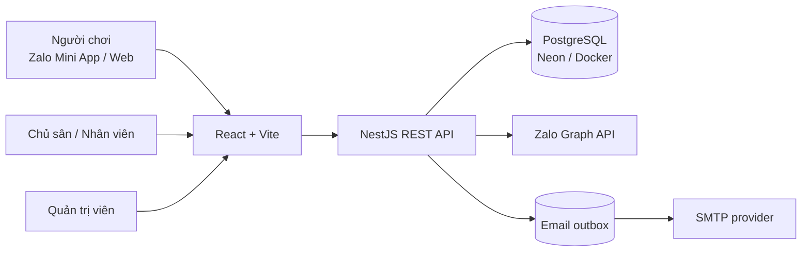

# datsan247

<p align="center">
  
</p>

<p align="center"><strong>Nền tảng tìm và đặt sân thể thao, xây dựng với trải nghiệm khách hàng trên Zalo Mini App.</strong></p>

<p align="center">
  <a href="https://datsan-miniapp.vercel.app/">Mở bản demo</a> ·
  <a href="https://datsan247-api.onrender.com/api/v1/health">Kiểm tra API</a>
</p>

datsan247 kết nối người chơi với chủ sân trong cùng một luồng: khách tìm địa điểm và giờ trống, xem giá rồi gửi đặt sân; chủ sân quản lý lịch, giá và nhân viên; quản trị viên duyệt địa điểm và giám sát hoạt động trên nền tảng.

Đây là dự án MVP cá nhân được triển khai thành web và API riêng. Giao diện khách hàng tích hợp Zalo Mini App SDK để lấy access token, vị trí, thông tin tài khoản và số điện thoại theo quyền được cấp.

> **Trạng thái demo:** Giao diện web và API đã được triển khai. Đăng nhập Zalo trên môi trường thật cần Mini App được kích hoạt và cấp quyền tương ứng trong Mini App Center. Thanh toán hiện là luồng mô phỏng; email cần SMTP và địa chỉ người gửi đã được xác minh.

## Tính năng

### Dành cho người chơi

- Khám phá địa điểm theo môn thể thao, tên/khu vực, khoảng giá, khoảng cách và thời gian muốn chơi.
- Xem giờ còn trống và giá sân do API tính từ cấu hình sân.
- Đặt sân, xem lịch sử và hủy lịch theo trạng thái booking.
- Đăng nhập bằng email hoặc tích hợp đăng nhập Zalo Mini App.
- Tạo, tham gia, rời hoặc báo cáo các trận ghép kèo cộng đồng.

### Dành cho chủ sân và nhân viên

- Đăng ký doanh nghiệp, gửi địa điểm để quản trị viên xét duyệt.
- Cấu hình sân, giờ hoạt động, thời lượng và giá.
- Quản lý lịch đặt trực tuyến và tạo booking tại quầy trên lịch sân.
- Khóa hoặc mở khung giờ, phân công nhân viên theo địa điểm.
- Xem báo cáo lượt đặt và giá trị booking trong khoảng thời gian.

### Dành cho quản trị viên nền tảng

- Duyệt hồ sơ doanh nghiệp và địa điểm.
- Quản lý môn thể thao, tài khoản và trạng thái hoạt động.
- Xem báo cáo tổng quan, nhật ký quản trị và xử lý báo cáo ghép kèo.
- Quyền admin được kiểm tra ở API; không thể tự cấp quyền qua luồng đăng ký công khai.

## Điểm kỹ thuật

- **Một lịch sân dùng chung:** booking trực tuyến, booking tại quầy và khung giờ bị khóa cùng ảnh hưởng đến kết quả tìm giờ trống.
- **Tính giờ và giá ở backend:** API kiểm tra cấu hình sân, booking hiện có và thời gian bị khóa; giao diện không tự quyết định giá cuối cùng.
- **Phân quyền theo vai trò và địa điểm:** khách, admin, chủ sân và nhân viên được giới hạn theo quyền tương ứng; nhân viên chỉ xem địa điểm được phân công.
- **Thông báo có hàng đợi:** sự kiện email xác nhận và nhắc lịch được ghi vào PostgreSQL outbox; SMTP chưa sẵn sàng thì email chưa được gửi và có thể được thử lại.
- **Triển khai tách lớp:** web trên Vercel, API trên Render và PostgreSQL trên Neon; migration được chạy khi API khởi động qua cấu hình Render.

## Kiến trúc



### Công nghệ

| Thành phần | Công nghệ |
| --- | --- |
| Giao diện khách, chủ sân và admin | React 19, TypeScript, Vite |
| Tích hợp Mini App | Zalo Mini App SDK (`zmp-sdk`) |
| API | NestJS, TypeScript, REST |
| Cơ sở dữ liệu | PostgreSQL, SQL migrations, Neon |
| Email | Nodemailer, SMTP, PostgreSQL outbox |
| Triển khai | Vercel (web), Render (API), Neon (database) |

## Chạy dự án local

### Yêu cầu

- Node.js 22.12 trở lên và npm.
- Docker Desktop hoặc Docker Engine có Docker Compose.

### Cài đặt

Từ thư mục gốc của repository:

```powershell
if (!(Test-Path .env)) { Copy-Item .env.example .env }
npm install
docker compose up -d postgres
```

Cập nhật `.env` trước khi chạy. Tối thiểu cần đặt `JWT_SECRET` (chuỗi ngẫu nhiên dài ít nhất 32 ký tự), `ADMIN_EMAIL` và `ADMIN_PASSWORD` (tối thiểu 12 ký tự). Giữ file `.env` ở máy local, không commit hoặc gửi secret qua chat.

Tạo cấu trúc database và tài khoản admin đầu tiên:

```powershell
npm run db:migrate
npm run db:seed:admin
```

Khởi động API và giao diện ở hai cửa sổ terminal riêng:

```powershell
npm run build:api
npm run dev:api
```

```powershell
npm run dev:web
```

Mở `http://localhost:5173`. API health check nằm tại `http://localhost:3000/api/v1/health`; trang admin tại `http://localhost:5173/admin/`.

Các biến chính trong `.env.example`:

| Biến | Mục đích |
| --- | --- |
| `DATABASE_URL` | Connection string PostgreSQL |
| `JWT_SECRET` | Ký access token của API |
| `ADMIN_EMAIL`, `ADMIN_PASSWORD` | Tạo tài khoản admin ban đầu |
| `VITE_API_URL` | URL API mà giao diện gọi, gồm `/api/v1` |
| `ZALO_APP_ID`, `VITE_ZALO_APP_ID` | Định danh Mini App; cần khớp cấu hình trong Mini App Center |
| `SMTP_HOST`, `SMTP_PORT`, `SMTP_SECURE`, `SMTP_USER`, `SMTP_PASSWORD`, `MAIL_FROM` | Cấu hình gửi email |

Không chạy `npm run db:seed:venues` trên database production trừ khi chủ động muốn thêm dữ liệu sân mẫu.

## Chạy và triển khai Zalo Mini App

Source giao diện dùng `zmp-sdk` cho access token, vị trí, thông tin người dùng và số điện thoại. Backend nhận access token tại `POST /api/v1/auth/zalo`, xác minh hồ sơ với Zalo rồi cấp JWT riêng cho datsan247.

Để liên kết với Mini App của bạn:

1. Cấu hình Mini App ID hợp lệ trong `apps/web/app-config.json` và các biến môi trường liên quan.
2. Đăng nhập Zalo CLI bằng `npm run zmp:login`.
3. Build và triển khai bằng `npm run zmp:deploy`.
4. Trong Mini App Center, kích hoạt ứng dụng, cấu hình domain và bật các quyền mà tính năng cần.

Chỉ luồng chạy trong Zalo Mini App thật mới cấp access token Zalo. Trình duyệt web thông thường không thể thay thế bước kích hoạt hoặc quyền truy cập đó. Chế độ phát triển có token giả để kiểm tra luồng local; token này không được chấp nhận trong production.

## API chính

API dùng tiền tố `/api/v1`.

| Nhóm | Endpoint tiêu biểu |
| --- | --- |
| Health và danh mục | `GET /health`, `GET /sports` |
| Đăng nhập | `/auth/login`, `/auth/customer/register`, `/auth/business/register`, `/auth/zalo`, `/auth/me` |
| Tìm sân | `GET /venues`, `GET /venues/:venueId`, `GET /venues/:venueId/courts/:courtId/availability` |
| Booking | `POST /bookings/courts/:courtId`, `GET /bookings/mine`, `POST /bookings/:bookingId/cancel` |
| Chủ sân | `/owner/businesses`, quản lý địa điểm, booking, giá, giờ khóa và nhân viên |
| Quản trị | `/admin/dashboard`, duyệt địa điểm/doanh nghiệp, quản lý môn và tài khoản |
| Ghép kèo | `/community/games`, tham gia/rời kèo và báo cáo nội dung |

## Kiểm tra

Repository có các lệnh kiểm tra luồng và tích hợp sau:

```powershell
npm run test:mvp
npm run test:explore
npm run test:zalo-auth
npm run test:notifications
npm run mail:verify
```

`test:mvp` cần PostgreSQL và kiểm tra các luồng nghiệp vụ trên schema thử nghiệm riêng. `mail:verify` chỉ kiểm tra kết nối/xác thực SMTP, không gửi email. Các lệnh kiểm tra không thay thế bước thử đăng nhập bằng tài khoản Zalo thật trong Mini App đã được kích hoạt.

## Triển khai

- **Web:** [datsan-miniapp.vercel.app](https://datsan-miniapp.vercel.app/)
- **API health:** [datsan247-api.onrender.com/api/v1/health](https://datsan247-api.onrender.com/api/v1/health)
- **Database:** PostgreSQL trên Neon.

Khi tự triển khai:

- API cần `DATABASE_URL`, `JWT_SECRET` và `CORS_ORIGINS` chứa origin của web đang dùng.
- Web cần `VITE_API_URL` trỏ đến API, ví dụ `https://datsan247-api.onrender.com/api/v1`.
- Render chạy migrations khi service khởi động. Sao lưu database trước khi triển khai migration có thể ảnh hưởng dữ liệu.
- Email production chỉ gửi được khi thông tin SMTP hợp lệ và địa chỉ `MAIL_FROM` được nhà cung cấp xác minh.

## Phạm vi hiện tại

- **Thanh toán:** luồng thanh toán tại sân và thanh toán demo; chưa tích hợp cổng thanh toán thật.
- **Đăng nhập Zalo:** đã có tích hợp SDK và xác minh token ở API; đăng nhập production còn phụ thuộc trạng thái kích hoạt, domain và quyền của Mini App.
- **Email:** đã có outbox và lịch nhắc; cần cấu hình SMTP cùng sender đã xác minh để nhận thư thực tế.

---

**Phát triển bởi Nguyễn Tất Ngọc**
